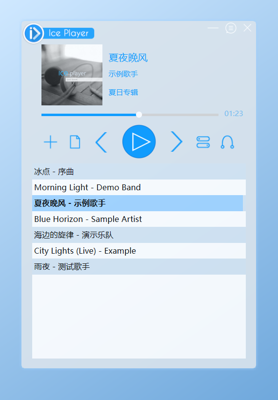

# IcePlayer (冰点播放器), Python + Qt

<p align="center">
  
</p>

A Python / PySide6 (Qt 6) version of **[IcePlayer](https://github.com/FreedomZZQ/IcePlayer)**
by [FreedomZZQ](https://github.com/FreedomZZQ), a C++/Qt5 music player. This project is based on it and keeps its skin images,
window layout and behaviour.

*The screenshot uses made-up demo songs. Regenerate it after UI changes with
`python docs/make_screenshot.py`.*

## Run

```bash
pip install -r requirements.txt
python run.py                 # or: python -m iceplayer
python run.py "D:/Music/song.mp3"
```

> Use PySide6 **6.10.2** (pinned in `requirements.txt`; the `qtapp` conda env has it).
>
> - **Not 6.8.x:** it can't play MP3s that have both an embedded cover picture and a
>   LAME header, which describes most store/iTunes files. The song "plays" at 0:00
>   with no sound.
> - **Not 6.12 on Miniconda base:** it fails with *"DLL load failed while importing
>   QtCore"* because that Python's MSVC runtime is too old.

## Features

- Main window (400×600, frameless, semi-transparent, drag to move): cover art, title
  (scrolls when long), artist, album, seek bar, time. Click anywhere on the seek bar
  to jump there, or drag the knob; playback moves when you release the mouse.
- Play/pause (pause fades out the volume), previous/next, volume popup, play-mode
  menu: 单曲播放 / 列表循环 / 单曲循环 / 随机播放. Space toggles play/pause.
- Playlist: double-click to play, right-click to add songs or a folder, remove one
  song or all. Drag files or folders onto the window. Missing files show "失效".
  Supports mp3, flac, wav, ogg, m4a, aac, wma, opus.
- Same look on every computer: the playlist's colours (blue/white stripes, black
  text, light-blue selection) and its background opacity are set in code, not taken
  from the Windows theme, and the app always uses light colours even when Windows is
  in dark mode. Make the list see-through by changing `PLAYLIST_ALPHA` in
  `iceplayer/player.py` (255 = solid, the default; 0 = invisible). As in the
  original, the whole window is 90% opaque on top of that (`setWindowOpacity(0.9)`).
- Desktop lyrics: an always-on-top bar that reads `song.lrc` next to the song file.
  UTF-8, UTF-16 and GBK files are all supported. Right-click the bar to hide it.
- Online lyrics: if the song has no `song.lrc`, showing the lyric bar (lyric button,
  or 桌面歌词 in the mini window) searches [lrclib.net](https://lrclib.net) in the
  background, by title + artist from the tags, or from an "Artist - Title" file name.
  If title + artist find nothing (e.g. the tag says "Jay Chou" but lrclib has
  周杰伦), it searches again by title only, and then accepts only versions within
  10 s of the song's length, so a different song with the same name isn't used.
  While the bar is open, every song change (next/previous, double-click, end of
  song) checks again: a song without `.lrc` is searched automatically once its
  tags are read (or after 2 s if it has none).
  The version whose length matches the song is used and saved as `song.lrc` next to
  it, so later plays work offline. The bar shows 正在搜索歌词… meanwhile, then
  没有找到歌词 (not searched again for that song) or 歌词搜索失败，请检查网络 (tried
  again next time the bar is shown). Only the title and artist are sent.
  Started from a console (`python run.py`, VS Code), every step is printed as
  `12:34:56 [歌词] ...`: the address searched, each result (album, length, timed or
  not), the one chosen and where the `.lrc` was saved. The packaged exe has no
  console and prints nothing.
- Cover art comes from `song.jpg` next to the song, then from art embedded in the
  file, then the default image.
- Mini mode: a 100×100 floating button. Right-click it for the menu; double-click
  it to go back to the main window.
- About dialog: click the logo.
- Single instance: running it again with a file plays that file in the open window.
- The playlist, volume and play mode are saved to `IceList.json`: next to `run.py`
  or a portable `IcePlayer.exe`, or in `%LOCALAPPDATA%\IcePlayer\` when installed
  with the MSI (Program Files isn't writable).

## Changes from the C++ version

- **Online lyrics come from lrclib.net; online covers were removed.** The Baidu
  Music API the original used no longer exists. Local `.lrc` and `.jpg` files,
  including ones the old version downloaded, still work.
- Qt 6 has no `QMediaPlaylist`, so play modes are handled in `playlist.py`.
- The playlist is now JSON (`IceList.json`) instead of the binary `IceList.ilst`.
- The app no longer registers itself as an `.mp3` handler in the registry. Use
  Windows "Open with" and point it at a launcher if you want that.

## Tests

```bash
pip install -r requirements-dev.txt
python -m pytest            # 408 tests, about 75 s
python -m pytest tests/test_lyrics.py -v    # one file, verbose
```

The tests run Qt on the `offscreen` platform, so no windows appear. They play
short generated WAV files, so an audio output device is needed. They never touch
your real `IceList.json` and never talk to a player you have open.

| File | Covers |
|---|---|
| `tests/test_lyrics.py` | LRC encoding detection, time-tag parsing, lyric lookup, desktop lyric window, online lyric search (title/artist guess, choosing a result, saving .lrc) |
| `tests/test_playlist.py` | audio file types, next/previous for every play mode, saving/loading state |
| `tests/test_widgets.py` | every skin image, hover buttons, scrolling title, volume popup, window dragging |
| `tests/test_player.py` | playlist add/remove/clear, dialogs, right-click menu, play/pause/fade, next/prev, end-of-song per mode, progress slider (follows playback, drag to seek, click jumps to the mouse), real-world MP3s (ID3 tags, embedded cover, LAME header), lyrics sync, online lyrics from the lyric button (searching message, saved .lrc, not found / failed / retry, answer for a previous song ignored), cover art, drag & drop, saving on close |
| `tests/test_mini.py` | about dialog, mini window buttons and menu, syncing with the main window |
| `tests/test_app.py` | single-instance handoff from a second process, where the playlist is saved, the real `run.py` / `python -m iceplayer` launchers |
| `tests/test_build.py` | the MSI builder (files, folders, shortcuts, upgrade rules, every wizard dialog and button), `build.py` helpers (version checks, portable naming, clean build PATH, no bundled ICU, stopping the single-file exe's process tree) |

## Build IcePlayer.exe

```bash
pip install -r requirements-dev.txt     # PyInstaller + pytest (once)
python build.py                         # check, test, build, smoke-test (~1.5 min)
python build.py --onefile               # ...and the single-file dist/IcePlayer-<version>-portable.exe
python build.py --msi                   # ...and the installer dist/IcePlayer-<version>.msi
python build.py --zip                   # ...and zip the folder version (rarely needed)
python build.py --skip-tests --no-clean # quick rebuild
```

The main result is `dist/IcePlayer/IcePlayer.exe`, the folder version (~130 MB):
the exe needs the `_internal` folder next to it. The MSI installs this folder.

`build.py` stops with a message (exit code 1) if PySide6 is older than 6.9 (the
MP3 cover-art bug), if PyInstaller is missing, if a test fails, or if a built exe
doesn't start, or if a foreign `icuuc.dll` got bundled. PyInstaller runs with a clean PATH (only
the building Python's folders and Windows), so the result is the same from PowerShell, Git Bash
or VS Code. Its self-check starts each exe off-screen with a short test song and
waits until the song is in the playlist file, so it proves the program really
started, and prints how long that took. In VS Code, **Ctrl+Shift+B** runs it; **Terminal → Run Task… →
"Build: installer (.msi)"** makes the MSI.

### The MSI installer

`python build.py --msi` also writes `dist/IcePlayer-<version>.msi` (~50 MB), made by
`msi.py` with Python's built-in `msilib` (needs Windows and Python 3.12 or older,
i.e. the `qtapp` env; no extra tools). Double-clicking it opens a setup wizard:

1. **Welcome** → **Choose the install folder** (default `C:\Program Files\IcePlayer`,
   can be changed) → **Install** → progress bar → **Setup is complete**, with a
   ticked **Launch IcePlayer now** box.
2. Cancel at any step asks "Are you sure?", then shows "Setup was interrupted.
   Nothing on your computer was changed."
3. Opening the MSI again while IcePlayer is installed offers **Repair** or **Remove**.

It:

- installs IcePlayer for all users (one admin prompt);
- adds **IcePlayer** to the Start menu and the desktop;
- lists IcePlayer, with its icon, in **Settings → Apps**, where it can be uninstalled;
- replaces an older installed version; refuses to install over a newer one.

The version comes from `__version__` in `iceplayer/__init__.py` (now 2.1.2).
**Raise it for every installer you hand out**, otherwise Windows can't tell the new
MSI is an upgrade. The installed program keeps its playlist in
`%LOCALAPPDATA%\IcePlayer\IceList.json`, so it survives upgrades and uninstalling.

For scripts only, the wizard can be skipped (silent install / uninstall, from an
admin terminal):

```bash
msiexec /i dist\IcePlayer-2.1.2.msi /qn
msiexec /x dist\IcePlayer-2.1.2.msi /qn
```

### Portable ("green") version: one exe

`python build.py --onefile` writes `dist/IcePlayer-<version>-portable.exe` (~52 MB):
**one file, nothing else needed**. Put it anywhere (a USB stick works too) and
double-click it: no installation, no admin rights, nothing written to the registry.
The playlist is saved as `IceList.json` next to the exe; delete both to remove it.

How it works, and what it costs compared with the folder version:

- Everything (Python, Qt, the skin images) is packed inside the exe. At each start
  it unpacks itself into a `_MEI…` folder in your temp folder (~130 MB) and runs from
  there; closing IcePlayer normally deletes that folder again.
- So it **starts a few seconds slower** (measured here: about 5–7 s, against 1–5 s
  for the folder version).
- If it is force-killed (Task Manager), the `_MEI…` folder stays behind in
  `%TEMP%` and can be deleted by hand.
- Self-unpacking exes are flagged by antivirus programs more often.

The file name gets `-dirty` when built from uncommitted changes, so test builds are
never mistaken for releases. (`--zip` still packs the folder version as
`IcePlayer-<version>-portable.zip`, if you prefer that.)

## Layout

```
build.py                build IcePlayer.exe (PyInstaller, see "Build IcePlayer.exe")
msi.py                  turn dist/IcePlayer into the .msi installer (used by build.py --msi)
docs/screenshot.png     README picture; docs/make_screenshot.py regenerates it
IcePlayer.spec          PyInstaller recipe: folder version (used by the MSI)
IcePlayer-onefile.spec  PyInstaller recipe: single-file portable exe (build.py --onefile)
run.py                  launcher
iceplayer/app.py        startup + single-instance (QLocalServer)
iceplayer/player.py     main window and playback
iceplayer/playlist.py   play-mode logic, saving
iceplayer/lyrics.py     LRC parser, lrclib.net search, desktop lyric window
iceplayer/mini.py       mini window + about dialog
iceplayer/widgets.py    hover buttons, scrolling label, seek slider, volume button, dragging
iceplayer/resources/    skin images (from the original IcePlayer, see Credits)
```

## Credits

- Based on **[IcePlayer](https://github.com/FreedomZZQ/IcePlayer)** by
  [FreedomZZQ](https://github.com/FreedomZZQ) (C++ / Qt5). The skin images in
  `iceplayer/resources/`, the window layout and the player's behaviour come from it.
- This version rewrites the program in Python with PySide6 (Qt 6) and adds tests,
  the build script and the MSI installer.

> **致原作者 / To the original author:** 本项目基于 [FreedomZZQ/IcePlayer](https://github.com/FreedomZZQ/IcePlayer)
> 修改而来。如果侵犯了你的版权，请告诉我（例如在本仓库提 issue），我会立刻删除本项目。
>
> This project is based on FreedomZZQ/IcePlayer. If it infringes your copyright,
> please let me know (for example by opening an issue in this repository) and I will
> delete this project immediately.
